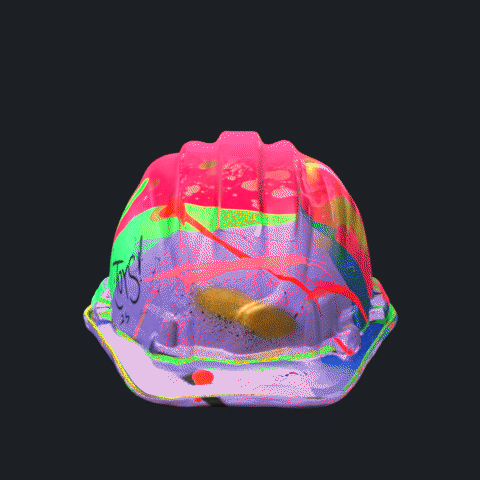
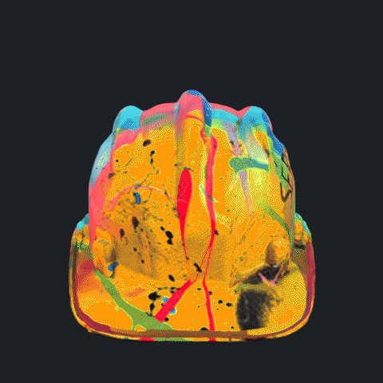
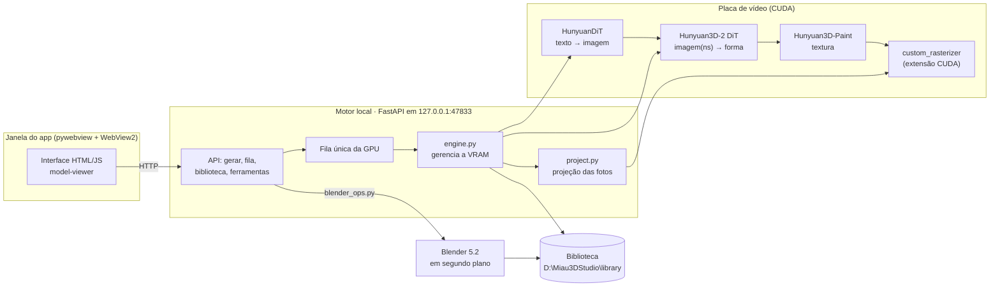

# Miau 3D Studio

Aplicativo de PC (Windows) que cria modelos 3D com inteligência artificial **rodando na sua própria placa de vídeo**. Grátis, sem assinatura e sem chave de API.

<p align="center">
  
  
</p>
<p align="center"><sub>Dois capacetes de obra pintados à mão, gerados no Miau 3D Studio a partir de 3 fotos cada (frente, esquerda e direita), com as fotos originais projetadas na textura.</sub></p>

## O que ele faz

- **Imagem → 3D**: uma foto ou desenho de um objeto vira um modelo 3D com textura.
- **Várias fotos → 3D**: fotos do mesmo objeto de vários lados (frente, esquerda, costas, direita) para uma forma mais fiel.
- **Texto → 3D**: descreva um objeto; o app cria uma imagem de referência e depois o modelo.
- **Fotos projetadas**: projeta as fotos originais sobre o modelo, como decalques. Cores, listras e textos escritos ficam iguais às fotos (veja os nomes nos capacetes acima).
- **Ferramentas (Blender)**: reduzir polígonos, remesh (voxel ou quads), altura real em cm, base para impressão 3D e exportação em GLB, FBX, OBJ, STL, USDZ e BLEND.
- **Biblioteca** com todos os modelos gerados, visualizador 3D e fila de gerações.

## Arquitetura



| Parte | Arquivo | Papel |
| --- | --- | --- |
| Janela | `app/main.py` | Abre uma janela própria do Windows e garante que o motor esteja no ar (sobe outro se ele cair). |
| Servidor | `app/server.py` | API local: fila de gerações (uma por vez na GPU), biblioteca em disco, ferramentas, arquivos. |
| Motor | `app/engine/engine.py` | Carrega os modelos de IA, decide o que fica na memória e executa cada etapa com progresso. |
| Projeção | `app/engine/project.py` | Encaixa cada foto na silhueta do modelo e projeta sobre a malha. |
| Blender | `app/engine/blender_ops.py` | Roda dentro do Blender em modo background: reduzir, remesh, escalar, base, exportar. |
| Interface | `app/ui/` | Telas de criar, biblioteca e detalhe, visualizador 3D (`model-viewer`). |

### Fluxo de uma geração

1. **Entrada**: a foto (ou fotos) tem o fundo removido; no modo texto, o HunyuanDiT cria primeiro uma imagem de referência.
2. **Forma**: o Hunyuan3D-2 DiT (versão turbo, 5 passos) gera a malha. No modo várias fotos usa o Hunyuan3D-2mv, que aceita até 4 vistas.
3. **Limpeza**: remove pedaços soltos e faces degeneradas, e reduz para ~40 mil faces.
4. **Textura**: o Hunyuan3D-Paint gera 6 vistas coloridas do objeto e as projeta numa textura 2048×2048. Todas as fotos enviadas servem de referência.
5. **Fotos projetadas** (opcional, padrão ligado): as fotos originais são projetadas por cima, e a textura da IA fica só onde nenhuma foto enxerga.
6. **Saída**: `forma.glb`, `modelo.glb` e `modelo_fotos.glb` na pasta do item na biblioteca.

### Gerenciamento de memória (12 GB de VRAM)

- Os modelos de forma e textura **ficam carregados** entre gerações, e a segunda geração seguida sai em ~1,5 min.
- O modelo de texto → imagem é grande e **descarrega os outros** quando é usado.
- Depois de **10 minutos sem uso**, tudo é descarregado e a memória volta para o sistema (útil com ArchiCAD e Blender abertos).
- Se a placa ficar sem memória, o motor libera tudo e mostra uma mensagem clara.

## Como o projeto foi feito

O objetivo era ter, no PC do escritório, um estúdio de geração 3D por IA no estilo das ferramentas online, **sem pagar por geração**. O caminho foi rodar modelos abertos localmente e construir o app em volta deles.

1. **Escolha do motor**: o Hunyuan3D-2 (Tencent) foi escolhido por cobrir forma, textura e várias vistas, ter licença gratuita válida no Brasil e caber numa placa de 12 GB com o modo de economia de memória.
2. **Ambiente no Windows**: Python 3.12, PyTorch 2.6 com CUDA 12.6, Visual Studio Build Tools e CUDA Toolkit, tudo no disco D:. As duas extensões nativas da textura (`custom_rasterizer` em CUDA e `mesh_processor` em C++) foram compiladas localmente.
3. **Compatibilidade**: o `transformers` 5.x renomeou camadas do DINOv2 e quebrava o carregamento dos pesos de jan/2025, então as bibliotecas foram fixadas em versões da época (`transformers 4.48.3`, `diffusers 0.32.2`). O modo texto precisou do `sentencepiece`.
4. **Primeiro teste**: a textura numa malha de 684 mil faces levou 37 minutos. Reduzir para 40 mil faces e usar o `mesh_processor` compilado baixou essa etapa para **42 segundos**.
5. **Velocidade de carregamento** (os modelos ficam num HD mecânico):
   - O carregamento da forma levava 156 s, quase todo gasto **preenchendo o modelo com números aleatórios** antes de sobrescrevê-los com os pesos reais. Pular essa inicialização (só em módulos carregados em modo estrito) levou o tempo a **14 s**.
   - A textura lia 14,6 GB de pesos em precisão cheia e os convertia para meia precisão logo depois. Uma cópia já convertida (`convert_fp16.py`, mesmos valores) cortou a leitura para 8,4 GB e o tempo de **195 s para 76 s**.
   - O `safetensors` lê o arquivo aos pedaços, fora de ordem, o que é lento em HD. Uma **leitura sequencial antes de carregar** deixa o arquivo no cache do Windows.
   - Resultado: a primeira geração com o app recém-aberto caiu de **10 a 18 min para ~4 min**.
6. **Fidelidade às fotos**: no modo várias fotos, a textura passou a usar todas as fotos e não só a da frente. Ainda assim a IA "reinterpretava" desenhos e textos. Daí veio a **projeção das fotos originais**, que reutiliza o rasterizador e as câmeras ortográficas do próprio Hunyuan3D-Paint:
   - renderiza a silhueta do modelo em cada lado;
   - encaixa a foto (sem fundo) nessa silhueta e mede o encaixe (IoU), descobrindo sozinha qual lado é esquerda e qual é direita;
   - projeta só os pixels do objeto, pesando pela inclinação da superfície (cos⁴), e mistura suavemente com a textura da IA.
7. **App de PC**: interface web própria numa janela nativa (pywebview), motor FastAPI local, biblioteca em disco e ferramentas do Blender por linha de comando.

## Requisitos

| Item | Testado com |
| --- | --- |
| Sistema | Windows 11 64 bits |
| Placa de vídeo | NVIDIA RTX 3060 12 GB |
| Memória RAM | 32 GB |
| Disco | ~80 GB livres (modelos de IA ~60 GB) |
| Blender | 5.2 (para as ferramentas de exportação) |
| Outros | Git, [uv](https://docs.astral.sh/uv/), WebView2 (já vem no Windows 11) |

Os caminhos estão fixos em `D:\Miau3DStudio`. Para instalar em outro lugar, ajuste `ROOT` em `app/engine/engine.py`, `app/server.py` e `app/main.py`, e os caminhos dos `.bat` em `tools/`.

## Instalação

1. **Clone este repositório** em `D:\Miau3DStudio`.
2. **Compilador e CUDA** (só para compilar as extensões de textura):
   - Visual Studio 2022 Build Tools com "Desenvolvimento para desktop com C++", em `D:\Miau3DStudio\tools\BuildTools`.
   - CUDA Toolkit 12.6 (componentes `nvcc`, `cudart`, `cublas_dev`, `cusparse_dev`, `cusolver_dev`, `curand_dev`, `thrust`), copiado para `D:\Miau3DStudio\tools\cuda\v12.6`.
3. **Python e pacotes**:
   ```bat
   set UV_PYTHON_INSTALL_DIR=D:\Miau3DStudio\tools\python
   uv python install 3.12
   uv venv --python 3.12 D:\Miau3DStudio\envs\miau
   uv pip install --python D:\Miau3DStudio\envs\miau\Scripts\python.exe -r requirements.txt --extra-index-url https://download.pytorch.org/whl/cu126 --index-strategy unsafe-best-match
   ```
4. **Código do Hunyuan3D-2**:
   ```bat
   git clone --depth 1 https://github.com/Tencent-Hunyuan/Hunyuan3D-2.git D:\Miau3DStudio\vendor\Hunyuan3D-2
   ```
5. **Extensões compiladas** (textura):
   ```bat
   tools\build-rasterizer.bat
   tools\build-mesh-processor.bat
   ```
6. **Modelos de IA** (Hugging Face, ~50 GB):
   ```bat
   hf download tencent/Hunyuan3D-2 --local-dir D:\Miau3DStudio\models\tencent\Hunyuan3D-2 --include "hunyuan3d-dit-v2-0-turbo/*" "hunyuan3d-paint-v2-0-turbo/*" "hunyuan3d-delight-v2-0/*" "hunyuan3d-vae-v2-0-turbo/*"
   hf download tencent/Hunyuan3D-2mv --local-dir D:\Miau3DStudio\models\tencent\Hunyuan3D-2mv --include "hunyuan3d-dit-v2-mv-turbo/*"
   hf download Tencent-Hunyuan/HunyuanDiT-v1.1-Diffusers-Distilled --local-dir D:\Miau3DStudio\models\Tencent-Hunyuan\HunyuanDiT-v1.1-Diffusers-Distilled
   ```
7. **Cópia em meia precisão dos modelos de textura** (mesmos valores usados na geração, metade da leitura):
   ```bat
   D:\Miau3DStudio\envs\miau\Scripts\python.exe app\engine\convert_fp16.py
   ```
8. **Ícone e atalho**: rode `app\make_icon.py` e crie um atalho para
   `D:\Miau3DStudio\envs\miau\Scripts\pythonw.exe "D:\Miau3DStudio\app\main.py"` com o ícone `app\miau.ico`
   (ou use `Miau3DStudio.bat`).

## Desempenho (RTX 3060 12 GB, modelos num HD mecânico)

| Situação | Tempo |
| --- | --- |
| Primeira geração com o app recém-aberto | ~4 min |
| Gerações seguintes (modelos já na memória) | ~1,5 min |
| Projeção das fotos originais | ~10 s dentro da geração |

## Licenças de terceiros

- **Hunyuan3D-2 / HunyuanDiT** (Tencent): Tencent Hunyuan Community License. O código e os pesos **não** fazem parte deste repositório; são baixados por quem instala. A licença **não vale na União Europeia, no Reino Unido e na Coreia do Sul** e exige licença comercial própria acima de 1 milhão de usuários ativos por mês.
- **model-viewer** (Google, BSD-3-Clause): incluído em `app/ui/vendor/model-viewer.min.js` com o aviso de licença original.
- **Blender**: GPL, instalado separadamente.
